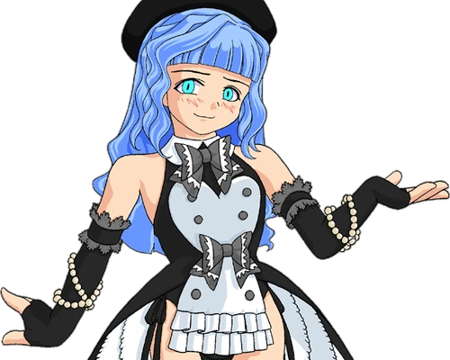
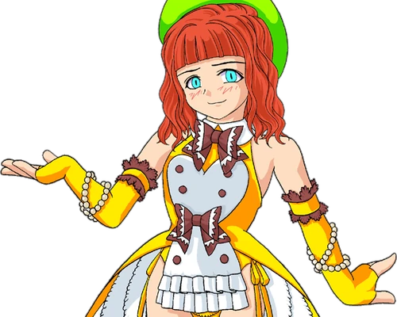
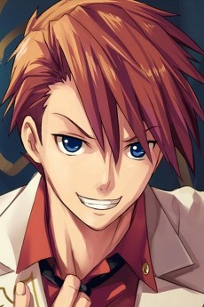
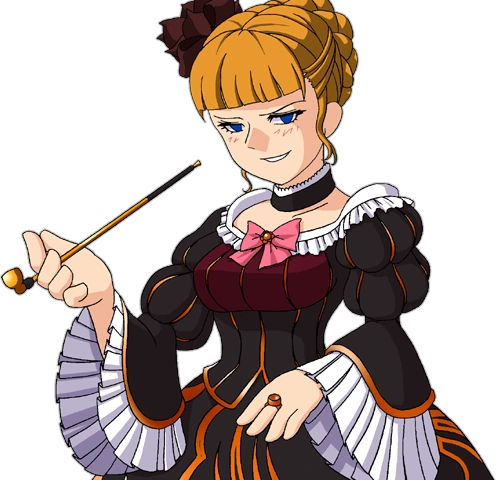
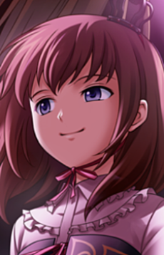
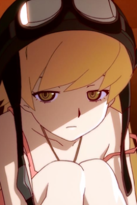
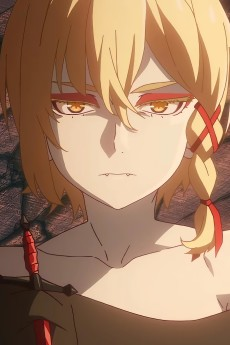
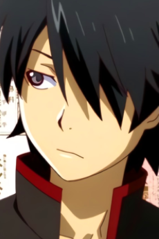
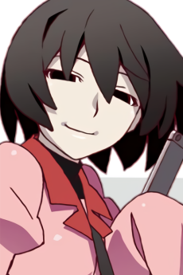
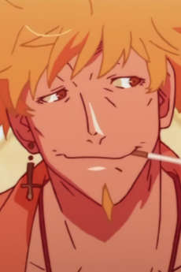

# 10 postaci z serii *Umineko* i *Monogatari*

## Wiedźmy, wampiry i inne osobliwości

Krótka prezentacja dziesięciu postaci z dwóch serii, w których tajemnica, nadprzyrodzone zjawiska i niejednoznaczni bohaterowie są równie ważni jak sama fabuła.

> **Uwaga:** opisy są krótkie i w większości bezspoilerowe. W przypadku kilku postaci ich przeszłość lub prawdziwa natura stanowią część zagadki.

### Spis postaci

| Seria | Postacie |
|---|---|
| *Umineko no Naku Koro ni* | Zepar, Furfur, Battler Ushiromiya, Beatrice, Maria Ushiromiya |
| *Monogatari* | Kiss-shot Acerola-orion Heart-under-blade, Deathtopia Virtuoso Suicide-Master, Koyomi Araragi, Ougi Oshino, Meme Oshino |

---

## 1. *Umineko no Naku Koro ni*

*Umineko* to seria Ryukishiego07, znana przede wszystkim z powieści wizualnej. Jej akcja skupia się na rodzinie Ushiromiya, spotykającej się na odciętej od świata wyspie Rokkenjima, oraz na sporze o to, czy za tajemniczymi wydarzeniami stoją ludzie, czy magia.

### Zepar

[Źródło ilustracji: Umineko Wiki](https://umineko.fandom.com/wiki/Zepar)

**Pełne imię:** Zepar  
**Pochodzenie:** *Umineko no Naku Koro ni*, przede wszystkim gra Beatrice w epizodzie *Dawn of the Golden Witch*.  
**Kim jest:** demon występujący w parze z Furfur.  
**Charakterystyka:** Zepar i Furfur prowadzą próbę miłości związaną z Battlerem i Beatrice. Zepar jest teatralny i lubi nadawać wydarzeniom formę widowiska. To postać nadnaturalna, więc jej pochodzenie nie jest przedstawione jako konkretne miasto czy kraj.

### Furfur

[Źródło ilustracji: Umineko Wiki](https://umineko.fandom.com/wiki/Furfur)

**Pełne imię:** Furfur  
**Pochodzenie:** *Umineko no Naku Koro ni*, ta sama nadnaturalna próba co u Zepara.  
**Kim jest:** partner Zepara i demon związany z próbą miłości.  
**Charakterystyka:** Furfur uzupełnia Zepara: razem komentują wydarzenia i pilnują reguł swojej gry. Ich duet wnosi do historii groteskowy humor, ale też przypomina, że w świecie *Umineko* nawet uczucia mogą stać się częścią bezlitosnego zakładu.

### Battler Ushiromiya

[Źródło ilustracji: AniList](https://anilist.co/character/14040)

**Pełne imię:** Battler Ushiromiya  
**Pochodzenie:** rodzina Ushiromiya; Rokkenjima, fikcyjna wyspa u wybrzeży Japonii.  
**Kim jest:** jeden z głównych bohaterów i uczestnik rodzinnego spotkania.  
**Charakterystyka:** Battler jest uparty, bezpośredni i nie chce bez namysłu przyjmować wyjaśnień opartych na magii. W centrum jego historii znajduje się próba odkrycia prawdy o wydarzeniach na wyspie.

### Beatrice

[Źródło ilustracji: Umineko Wiki](https://umineko.fandom.com/wiki/Beatrice)

**Pełne imię:** Beatrice, Złota Wiedźma  
**Pochodzenie:** *Umineko no Naku Koro ni*; jest związana z Rokkenjima i legendą o ukrytym złocie.  
**Kim jest:** potężna wiedźma oraz główna przeciwniczka Battlera w sporze o naturę wydarzeń.  
**Charakterystyka:** Beatrice jest pewna siebie, błyskotliwa i skłonna do teatralnych gestów. Jej opowieść nie sprowadza się jednak do roli czarnego charakteru: zrozumienie jej motywacji jest częścią zagadki.

### Maria Ushiromiya

[Źródło ilustracji: AniList](https://anilist.co/character/8555)

**Pełne imię:** Maria Ushiromiya  
**Pochodzenie:** rodzina Ushiromiya; Rokkenjima.  
**Kim jest:** najmłodsza uczestniczka rodzinnego spotkania, córka Rosy Ushiromiyi.  
**Charakterystyka:** Maria interesuje się magią, wiedźmami i okultyzmem. Jej dziecięca perspektywa sprawia, że inaczej niż dorośli interpretuje wydarzenia na wyspie. Jest ważną postacią dla tematu wiary i wyobraźni.

---

## 2. *Monogatari*

*Monogatari* powstało na podstawie powieści Nisio Isina, a jego adaptacja anime jest kojarzona ze studiem SHAFT. Seria opowiada o Koyomim Araragim i osobliwościach, które wpływają na życie jego oraz spotykanych przez niego osób.

### Kiss-shot Acerola-orion Heart-under-blade

[Źródło ilustracji: AniList](https://anilist.co/character/23602)

**Pełne imię:** Kiss-shot Acerola-orion Heart-under-blade  
**Inne imię:** Shinobu Oshino  
**Pochodzenie:** *Monogatari*; jej historię poznajemy szczególnie w *Kizumonogatari*.  
**Kim jest:** pradawna i niezwykle potężna wampirzyca, która staje się ważną częścią życia Koyomiego.  
**Charakterystyka:** Kiss-shot jest dumna, charyzmatyczna i przyzwyczajona do tego, że inni się jej boją. Jej relacja z Koyomim zmienia się wraz z wydarzeniami, a imię Shinobu wiąże się z jej późniejszą, dziecięcą postacią.

### Deathtopia Virtuoso Suicide-Master

[Źródło ilustracji: AniList](https://anilist.co/character/138020)

**Pełne imię:** Deathtopia Virtuoso Suicide-Master  
**Pochodzenie:** późniejsza część *Monogatari*, przede wszystkim *Shinobumonogatari* (*Shinobu Mustard*).  
**Kim jest:** wampirzyca związana z historią Shinobu i dawnym światem wampirów.  
**Charakterystyka:** jej niezwykłe imię pasuje do mrocznego, groteskowego tonu tej części serii. Deathtopia jest postacią pewną siebie i niebezpieczną; jej spotkanie z Shinobu odsłania fragmenty przeszłości, której ta wolałaby nie pamiętać.

### Koyomi Araragi

[Źródło ilustracji: AniList](https://anilist.co/character/22036)

**Pełne imię:** Koyomi Araragi  
**Pochodzenie:** *Monogatari*; uczeń liceum Naoetsu w Japonii.  
**Kim jest:** główny bohater serii.  
**Charakterystyka:** Koyomi jest uparty i często angażuje się w problemy innych, nawet gdy sprowadza to na niego kłopoty. Po spotkaniu z Kiss-shot sam zostaje częściowo przemieniony w wampira, co łączy go ze światem osobliwości.

### Ougi Oshino

[Źródło ilustracji: AniList](https://anilist.co/character/87886)

**Pełne imię:** Ougi Oshino  
**Pochodzenie:** *Monogatari*; uczeń liceum Naoetsu i krewny Meme Oshino, jak sam twierdzi.  
**Kim jest:** tajemnicza postać, która pojawia się w życiu Koyomiego i zadaje mu dociekliwe pytania.  
**Charakterystyka:** Ougi jest spokojny, spostrzegawczy i lubi prowadzić rozmówców do wniosków, których sami nie chcieli zobaczyć. Jego opowieści często mają drugie dno.

### Meme Oshino

[Źródło ilustracji: AniList](https://anilist.co/character/22552)

**Pełne imię:** Meme Oshino  
**Pochodzenie:** *Monogatari*; działa w okolicach miasta, w którym mieszkają bohaterowie, a jego bazą jest opuszczony budynek dawnej szkoły przygotowawczej.  
**Kim jest:** niezależny specjalista od osobliwości i pośrednik pomagający ludziom uwikłanym w sprawy nadprzyrodzone.  
**Charakterystyka:** Meme jest spokojny, ironiczny i rzadko podaje gotowe odpowiedzi. Zamiast rozwiązywać problemy za innych, pomaga im zrozumieć sytuację i znaleźć własne wyjście.

---

## Zestawienie

| Postać | Seria | Najważniejszy motyw |
|---|---|---|
| Zepar | *Umineko* | próba miłości i reguły gry |
| Furfur | *Umineko* | magia, duet i teatralność |
| Battler Ushiromiya | *Umineko* | poszukiwanie prawdy |
| Beatrice | *Umineko* | zagadka, magia i motywacje |
| Maria Ushiromiya | *Umineko* | wiara i wyobraźnia |
| Kiss-shot Acerola-orion Heart-under-blade | *Monogatari* | wampiryzm i więź z Koyomim |
| Deathtopia Virtuoso Suicide-Master | *Monogatari* | przeszłość wampirów |
| Koyomi Araragi | *Monogatari* | pomoc innym i osobliwości |
| Ougi Oshino | *Monogatari* | zagadki i dociekliwe pytania |
| Meme Oshino | *Monogatari* | wiedza o osobliwościach |

## Źródła serii

- Ryukishi07, *Umineko no Naku Koro ni* oraz *Umineko no Naku Koro ni Chiru*.
- Nisio Isin, seria powieści *Monogatari*, w tym *Kizumonogatari* i *Shinobumonogatari*.
- Adaptacje anime: *Umineko no Naku Koro ni* oraz seria anime *Monogatari*.
