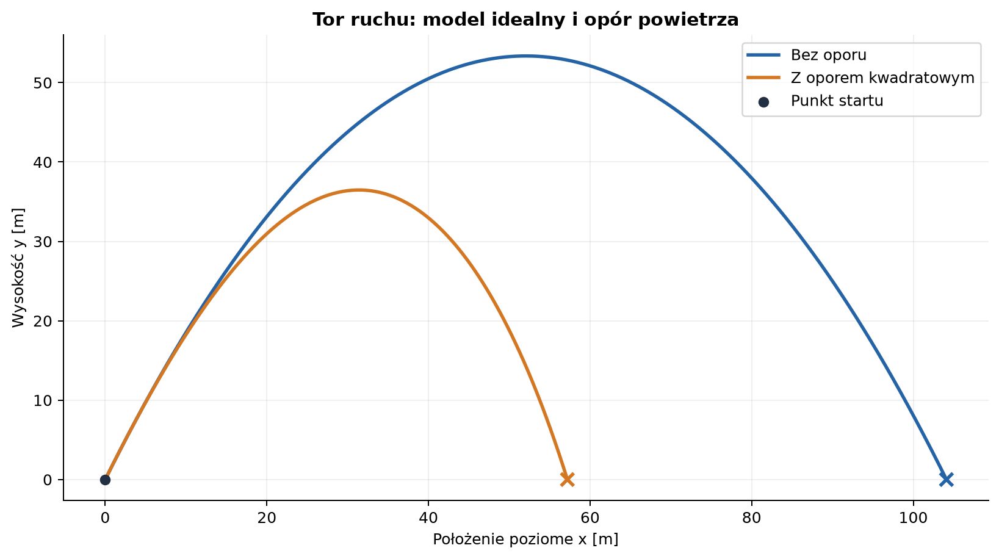
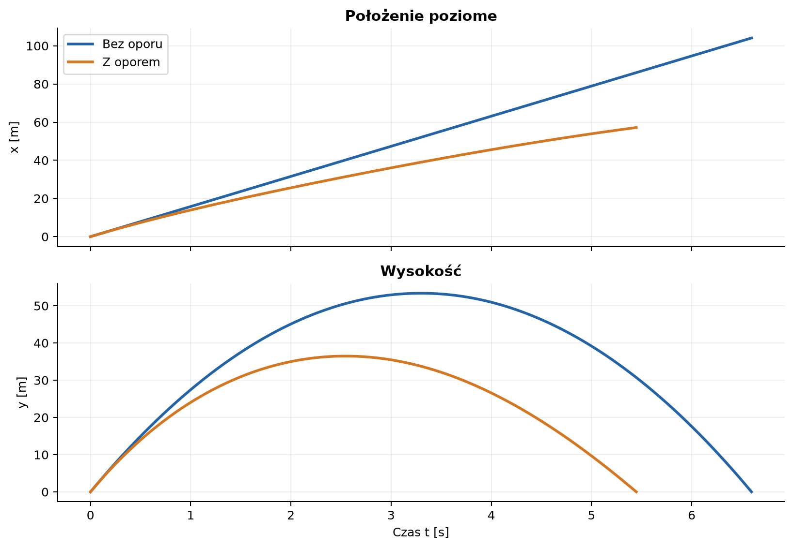
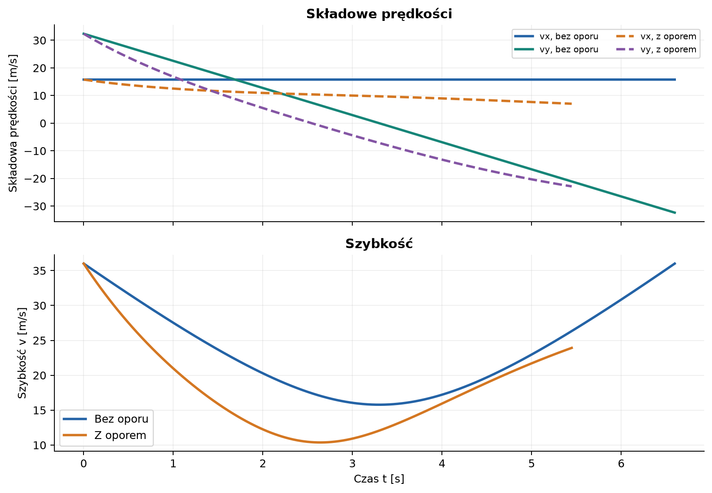
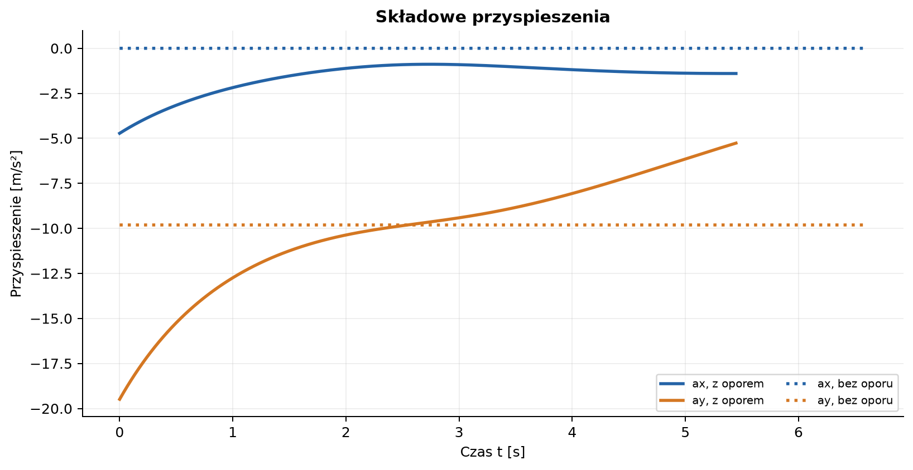
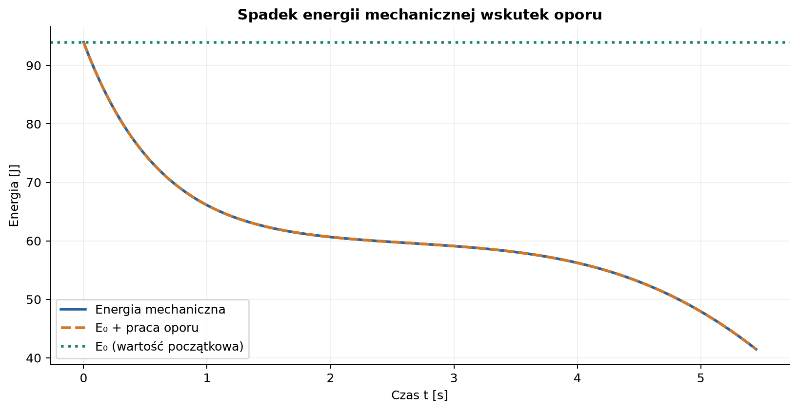

# Rzut ukośny bez oporu i z oporem powietrza

*Raport obliczeniowy: wyprowadzenie równań, porównanie modeli i wykresy wygenerowane w Pythonie.*

**Parametry zadania:** prędkość początkowa $v_0=36\,\mathrm{m/s}$, kąt $\alpha=1{,}11701\,\mathrm{rad}$ (wartość wejściowa: $64^\circ$). **Metoda:** rozwiązanie analityczne bez oporu oraz całkowanie numeryczne z kwadratowym oporem powietrza. **Charakter wyników:** obliczenia modelowe, nie pomiar laboratoryjny.

## Spis treści

1. [Cel i założenia](#1-cel-i-założenia)
2. [Rzut ukośny bez oporu](#2-rzut-ukośny-bez-oporu)
3. [Przykład liczbowy bez oporu](#3-przykład-liczbowy-bez-oporu)
4. [Rzut ukośny z oporem powietrza](#4-rzut-ukośny-z-oporem-powietrza)
5. [Wyniki i porównanie](#5-wyniki-i-porównanie)
6. [Kod i odtwarzanie wykresów](#6-kod-i-odtwarzanie-wykresów)
7. [Ograniczenia modelu i wnioski](#7-ograniczenia-modelu-i-wnioski)

---

## 1. Cel i założenia

Rzut ukośny jest ruchem w dwóch wymiarach, który można rozłożyć na ruch poziomy i pionowy. W próżni składowe te łączy wyłącznie warunek wspólnego czasu. W atmosferze prędkość zmienia dodatkowo siła oporu, a składowe przestają być niezależne.

Przyjmujemy układ współrzędnych, w którym $x$ jest poziomy, $y$ skierowany pionowo w górę, a początek układu leży w miejscu wyrzutu. Poziom lądowania ma $y=0$. Pomijamy rozmiar ciała i obrót; nie ma wiatru ani siły nośnej. Przyspieszenie grawitacyjne jest stałe.

### 1.1. Parametry i jednostki

| Symbol | Znaczenie | Wartość | Jednostka SI |
| :--- | :--- | ---: | :---: |
| $v_0$ | wartość prędkości początkowej | $36$ | $\mathrm{m/s}$ |
| $\alpha$ | kąt wyrzutu | $1{,}11701\,\mathrm{rad}$ ($64^\circ$ z danych wejściowych) | $\mathrm{rad}$ |
| $g$ | przyspieszenie grawitacyjne | $9{,}81$ | $\mathrm{m/s^2}$ |
| $m$ | masa przykładowej piłki | $0{,}145$ | $\mathrm{kg}$ |
| $d$ | średnica piłki | $0{,}073$ | $\mathrm{m}$ |
| $\rho$ | gęstość powietrza | $1{,}225$ | $\mathrm{kg/m^3}$ |
| $C_D$ | współczynnik oporu kuli | $0{,}47$ | bezwymiarowy |
| $A$ | pole przekroju kuli, $\pi d^2/4$ | $0{,}004185$ | $\mathrm{m^2}$ |

Wartość kąta podano w stopniach, bo tak najłatwiej ją odczytać z warunku. Wzory trygonometryczne i kod używają kąta w radianach:

$$
\alpha=64^\circ\frac{\pi}{180^\circ}=1{,}117010721\,\mathrm{rad}.
$$

Warunki początkowe są następujące:

$$
x(0)=0,\qquad y(0)=0,\qquad
v_x(0)=v_0\cos\alpha,\qquad v_y(0)=v_0\sin\alpha.
$$

## 2. Rzut ukośny bez oporu

### 2.1. Rozkład prędkości i równania ruchu

Bez oporu jedyną siłą jest ciężar $\vec F_g=(0,-mg)$. Z drugiej zasady Newtona, $m\vec a=\sum\vec F$, wynika:

$$
a_x=0,\qquad a_y=-g.
$$

Korzystając z początkowego kierunku prędkości, jej składowe wynoszą:

$$
v_{x0}=v_0\cos\alpha,\qquad v_{y0}=v_0\sin\alpha.
$$

Całkowanie przyspieszenia po czasie daje składowe prędkości:

$$
v_x(t)=v_0\cos\alpha,\qquad
v_y(t)=v_0\sin\alpha-gt.
$$

Ponowne całkowanie z warunkami $x(0)=y(0)=0$ prowadzi do równań położenia:

$$
x(t)=v_0\cos\alpha\,t,
\qquad
y(t)=v_0\sin\alpha\,t-\frac{1}{2}gt^2.
$$

W poziomie ruch jest jednostajny, a w pionie jednostajnie zmienny. Wierzchołek toru osiągany jest, gdy prędkość pionowa zanika:

$$
v_y(t_{\mathrm{w}})=0
\quad\Longrightarrow\quad
t_{\mathrm{w}}=\frac{v_0\sin\alpha}{g}.
$$

### 2.2. Równanie toru

Z równania poziomego wyznaczamy czas:

$$
t=\frac{x}{v_0\cos\alpha}.
$$

Podstawienie do równania $y(t)$ eliminuje czas:

$$
y(x)=x\tan\alpha-\frac{g x^2}{2v_0^2\cos^2\alpha}.
$$

Tor w modelu bez oporu jest parabolą. Jej przecięcie z poziomem $y=0$ poza punktem startu określa zasięg $R$:

$$
0=R\tan\alpha-\frac{gR^2}{2v_0^2\cos^2\alpha}
\quad\Longrightarrow\quad
R=\frac{v_0^2\sin(2\alpha)}{g}.
$$

Przy lądowaniu na tej samej wysokości czas lotu i maksymalna wysokość to:

$$
t_{\mathrm{lot}}=\frac{2v_0\sin\alpha}{g},
\qquad
h_{\max}=\frac{v_0^2\sin^2\alpha}{2g}.
$$

### 2.3. Zachowanie energii

W modelu idealnym nie ma siły rozpraszającej energię. Przy poziomie odniesienia energii potencjalnej na wysokości $y=0$:

$$
E=\frac{1}{2}m(v_x^2+v_y^2)+mgy=\mathrm{const}.
$$

Wzrost energii potencjalnej podczas wznoszenia równoważy spadek energii kinetycznej. Po osiągnięciu tej samej wysokości co miejsce startu szybkość ponownie wynosi $v_0$.

## 3. Przykład liczbowy bez oporu

Składowe prędkości początkowej po podstawieniu danych są równe:

$$
v_{x0}=36\cos(1{,}117010721)=15{,}7814\,\mathrm{m/s},
\qquad
v_{y0}=36\sin(1{,}117010721)=32{,}3566\,\mathrm{m/s}.
$$

Wyniki analityczne:

| Wielkość | Wynik bez oporu |
| :--- | ---: |
| Czas do wierzchołka $t_{\mathrm{w}}$ | $3{,}297\,\mathrm{s}$ |
| Czas lotu $t_{\mathrm{lot}}$ | $6{,}597\,\mathrm{s}$ |
| Zasięg $R$ | $104{,}104\,\mathrm{m}$ |
| Maksymalna wysokość $h_{\max}$ | $53{,}361\,\mathrm{m}$ |
| Początkowa energia kinetyczna dla $m=0{,}145\,\mathrm{kg}$ | $93{,}960\,\mathrm{J}$ |



*Rysunek 1. Współrzędne na osiach są podane w metrach. Opór skraca zasięg i obniża wierzchołek toru.*



*Rysunek 2. Poziome położenie z oporem nie jest liniowe w czasie, ponieważ opór zmniejsza $v_x$.*

## 4. Rzut ukośny z oporem powietrza

### 4.1. Kwadratowe prawo oporu

Dla ciała poruszającego się w powietrzu z dostatecznie dużą prędkością przyjmujemy model kwadratowego oporu. Siła jest skierowana przeciwnie do wektora prędkości, a jej wartość rośnie z kwadratem szybkości:

$$
\vec F_D=-\frac{1}{2}\rho C_D A\,|\vec v|\,\vec v.
$$

Symbol $|\vec v|=\sqrt{v_x^2+v_y^2}$ oznacza szybkość, a nie składową prędkości. Minus zapewnia, że opór zawsze działa przeciwnie do ruchu. Dla kuli pole czołowe to $A=\pi d^2/4$.

Z drugiej zasady Newtona dla składowych:

$$
m\dot v_x=-\frac{1}{2}\rho C_D A\,|\vec v|v_x,
\qquad
m\dot v_y=-mg-\frac{1}{2}\rho C_D A\,|\vec v|v_y.
$$

Po podzieleniu przez masę otrzymujemy równania przyspieszenia:

$$
\dot v_x=-k|\vec v|v_x,\qquad
\dot v_y=-g-k|\vec v|v_y,\qquad
k=\frac{\rho C_D A}{2m}.
$$

Wraz z $\dot x=v_x$ i $\dot y=v_y$ jest to układ czterech sprzężonych równań pierwszego rzędu. Przyspieszenie poziome nie jest już zerowe, a równanie pionowe nie ma stałego przyspieszenia. Dlatego nie otrzymujemy parabolicznego toru ani prostych wzorów na czas lotu i zasięg.

### 4.2. Rozwiązanie numeryczne metodą RK4

Stan układu zapisujemy jako $\mathbf{s}=(x,y,v_x,v_y)$. Dla układu $\dot{\mathbf{s}}=\mathbf{f}(t,\mathbf{s})$ metoda Rungego–Kutty czwartego rzędu oblicza kolejny stan:

$$
\begin{aligned}
\mathbf{k}_1&=\mathbf{f}(t,\mathbf{s}),\\
\mathbf{k}_2&=\mathbf{f}\left(t+\frac{\Delta t}{2},\mathbf{s}+\frac{\Delta t}{2}\mathbf{k}_1\right),\\
\mathbf{k}_3&=\mathbf{f}\left(t+\frac{\Delta t}{2},\mathbf{s}+\frac{\Delta t}{2}\mathbf{k}_2\right),\\
\mathbf{k}_4&=\mathbf{f}(t+\Delta t,\mathbf{s}+\Delta t\mathbf{k}_3),\\
\mathbf{s}(t+\Delta t)&=\mathbf{s}(t)+\frac{\Delta t}{6}
(\mathbf{k}_1+2\mathbf{k}_2+2\mathbf{k}_3+\mathbf{k}_4).
\end{aligned}
$$

W skrypcie użyto kroku $\Delta t=0{,}002\,\mathrm{s}$. Całkowanie kończy się przy powrocie do ziemi; położenie punktu lądowania jest interpolowane między ostatnimi dwoma krokami. Skrypt sprawdza również bilans energii: zmiana energii mechanicznej powinna odpowiadać pracy wykonanej przez siłę oporu.



*Rysunek 3. Bez oporu $v_x$ jest stałe. W obecności oporu obie składowe prędkości się zmieniają.*



*Rysunek 4. Opór zmienia przyspieszenie zależnie od chwilowego wektora prędkości.*

### 4.3. Bilans energii przy oporze

Energia mechaniczna pocisku w polu grawitacyjnym wynosi $E_m=\frac{1}{2}m|\vec v|^2+mgy$. Opór wykonuje ujemną pracę. Moc tej siły jest równa:

$$
P_D=\vec F_D\cdot\vec v
=-\frac{1}{2}\rho C_D A|\vec v|^3\leq 0.
$$

Zatem energia mechaniczna maleje:

$$
\frac{dE_m}{dt}=P_D,
\qquad
E_m(t)=E_m(0)+\int_0^t P_D(\tau)\,d\tau.
$$



*Rysunek 5. Zgodność obu krzywych jest numeryczną kontrolą rozwiązania i obliczonej pracy oporu.*

## 5. Wyniki i porównanie

| Wielkość | Bez oporu | Z oporem kwadratowym |
| :--- | ---: | ---: |
| Czas lotu | $6{,}597\,\mathrm{s}$ | $5{,}447\,\mathrm{s}$ |
| Zasięg | $104{,}104\,\mathrm{m}$ | $57{,}192\,\mathrm{m}$ |
| Maksymalna wysokość | $53{,}361\,\mathrm{m}$ | $36{,}477\,\mathrm{m}$ |
| Prędkość pozioma podczas lotu | stała: $15{,}781\,\mathrm{m/s}$ | maleje |
| Energia mechaniczna | stała | maleje wskutek oporu |

Wyniki z oporem uzyskano dla kuli o zadanej masie i średnicy. Zasięg jest mniejszy o około $45\%$, a maksymalna wysokość o około $32\%$ w stosunku do modelu bez oporu. Wartości te zależą od przyjętej masy, rozmiaru ciała, gęstości powietrza i współczynnika $C_D$; nie wynikają wyłącznie z $v_0$ i $\alpha$. Są oszacowaniem dla opisanego modelu, a nie uniwersalnym wynikiem każdego rzutu.

## 6. Kod i odtwarzanie wykresów

Kompletny, uruchamialny kod znajduje się w pliku [generuj_wykresy_rzut_ukosny.py](generuj_wykresy_rzut_ukosny.py). Zawiera parametry modelu, metodę RK4, obliczenia obu wariantów ruchu, kontrolę bilansu energii i kod zapisujący wszystkie pięć załączonych wykresów. Kluczowe fragmenty równania ruchu i integratora:

```python
def acceleration(vx, vy):
    speed = math.hypot(vx, vy)
    drag_per_mass = DRAG_FACTOR * speed / MASS
    return -drag_per_mass * vx, -G - drag_per_mass * vy

def derivative(state):
    x, y, vx, vy = state
    ax, ay = acceleration(vx, vy)
    return vx, vy, ax, ay

def rk4_step(state, step):
    k1 = derivative(state)
    state2 = tuple(s + 0.5 * step * k for s, k in zip(state, k1))
    k2 = derivative(state2)
    state3 = tuple(s + 0.5 * step * k for s, k in zip(state, k2))
    k3 = derivative(state3)
    state4 = tuple(s + step * k for s, k in zip(state, k3))
    k4 = derivative(state4)
    return tuple(
        s + step * (a + 2*b + 2*c + d) / 6
        for s, a, b, c, d in zip(state, k1, k2, k3, k4)
    )
```

Fragment pokazuje rzeczywiste funkcje z dostarczonego skryptu. Do rysowania wymagany jest `matplotlib`; całkowanie korzysta wyłącznie ze standardowej biblioteki Pythona.

Uruchomienie z głównego katalogu repozytorium:

```bash
python3 -m pip install matplotlib
python3 pages/solutions/04_sol_vscode/generuj_wykresy_rzut_ukosny.py
```

Pliki PNG zostaną zapisane w podfolderze [`wykresy/`](wykresy/). Skrypt nie wymaga uruchamiania Google Colab.

## 7. Ograniczenia modelu i wnioski

- **Bez oporu** ruch poziomy jest jednostajny, ruch pionowy ma stałe przyspieszenie $-g$, a tor jest parabolą.
- **Z oporem** siła zależy od szybkości i jej zwrotu. Składowe ruchu są sprzężone i do uzyskania liczb potrzebne jest całkowanie równań.
- W przyjętym modelu oporu zakładamy stałą gęstość powietrza i stały współczynnik $C_D$. W rzeczywistości współczynnik może zależeć od kształtu, orientacji i liczby Reynoldsa.
- Pominięto wiatr, obrót, siłę Magnusa, wypór oraz zmianę gęstości powietrza z wysokością. Są to istotne poprawki w dokładnym opisie realnej piłki.
- Wszystkie długości, masy, czasy i prędkości podano w jednostkach SI. Kąt w równaniach i obliczeniach numerycznych wyrażany jest w radianach.

Rozkład na składowe umożliwia proste analityczne rozwiązanie rzutu idealnego. Opór powietrza usuwa tę prostotę, ale zarazem pozwala lepiej opisać rzeczywiste trajektorie. Porównanie wykresów pokazuje, jak założenia modelu wpływają na zasięg, wysokość, prędkość i energię.